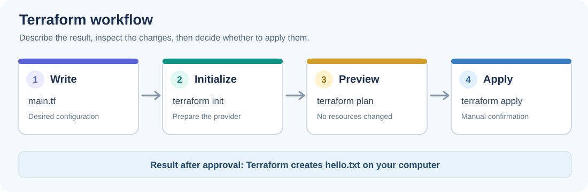

# 01. What is Terraform?

**Goal:** Understand Infrastructure as Code (IaC) and use Terraform to create, change, and remove one local file.

**Estimated practice time:** 20 to 30 minutes  
**Prerequisites:** [Terraform installed](https://developer.hashicorp.com/terraform/install), a terminal, and internet access for downloading the Local provider on first use.  
**Cloud account required:** No.

## 1. The idea

Imagine you need the same file or server configuration several times.

- **Manual approach:** Create each resource yourself and try to remember every setting.
- **Infrastructure as Code:** Describe what you want in a text file and let a tool manage the resources.

**Terraform** is an Infrastructure as Code tool. You write the **desired state** in configuration files (usually ending in `.tf`). Terraform compares that configuration with what it knows about existing resources and proposes the necessary changes.

Terraform is **declarative**: you describe the result you want, not every click needed to produce it.

Three words to remember:

| Term | Simple meaning | In this example |
| --- | --- | --- |
| Configuration | What you want Terraform to manage | The `.tf` files |
| Resource | One thing Terraform manages | A text file on your computer |
| Provider | A plugin that works with a type of resource | `hashicorp/local` |

You will explore providers in [module 02](../02-providers/README.md) after that module is published.

## 2. The Terraform workflow



1. **Write** configuration in `.tf` files.
2. **Initialize** with `terraform init` to prepare the working directory and download the provider.
3. **Preview** with `terraform plan` to inspect proposed changes. This does not create the file.
4. **Apply manually** with `terraform apply` and confirm the prompt to make the changes.
5. **Clean up manually** with `terraform destroy` when finished.

> Terraform can manage real cloud infrastructure, but this course starts with a local file so you can practice without an Azure subscription.

## 3. Read the example

Open [`example/main.tf`](example/main.tf):

```hcl
resource "local_file" "welcome" {
  content  = "Hello from Terraform!\n"
  filename = "${path.module}/hello.txt"
}
```

Read it from top to bottom:

- `resource` declares something Terraform should manage.
- `local_file` is the resource type. It creates a file on your computer.
- `welcome` is a name used inside this Terraform configuration.
- `content` is what the file should contain.
- `filename` is the path to the generated file.
- `path.module` points to the directory containing this example.

The separate [`example/versions.tf`](example/versions.tf) declares the Terraform and provider version requirements.

## 4. Guided lab: create your first resource

**Start in the root of the cloned repository.** Run each command yourself.

### Step A: enter the example folder

```sh
cd 01-what-is-terraform/example
terraform version
```

You should see a Terraform version. If the command is not found, install Terraform before continuing.

### Step B: initialize

```sh
terraform init
```

Expected: Terraform initializes successfully and installs the Local provider. This does **not** create `hello.txt`.

### Step C: check and preview

```sh
terraform fmt -check
terraform validate
terraform plan
```

Expected: the configuration is valid, and the plan proposes **1 to add**. Open [`main.tf`](example/main.tf) if you want to see the resource again.

### Step D: apply only after reviewing the plan

```sh
terraform apply
```

Terraform will show the plan again and ask for confirmation. Type `yes` **only if you agree** with the proposed action.

Expected: a new `hello.txt` file appears in the example folder with:

```text
Hello from Terraform!
```

### Step E: make one small change

Change `Hello from Terraform!` to `My first Terraform change!` in `main.tf`, then run:

```sh
terraform plan
```

**Stop and read the plan.** Did Terraform recognize the content change?

When ready, run `terraform apply` and confirm manually. Check the updated `hello.txt`.

### Step F: clean up

```sh
terraform plan -destroy
terraform destroy
```

Review the destroy preview first. Confirm `terraform destroy` manually to delete the file managed by Terraform.

**Important:** Terraform also creates local working data, including a `.terraform/` directory and a state file. State can contain sensitive information and must not be committed. The repository's `.gitignore` excludes it. State is explained in module 04.

> **From the field**
> In real projects, changes made manually outside Terraform can cause configuration drift.
> A new `terraform plan` can reveal differences between the code and the actual resources.
> Review the plan, update the configuration for intended changes, and avoid blindly applying it.

## 5. Independent challenge

Complete the [module 01 challenge](../exercises/01-what-is-terraform/README.md) without following a full solution. You will create a second local file, inspect the plan, and remove both files safely.

## 6. Check your understanding

1. What is the main difference between a manual setup and Infrastructure as Code?
2. Which command shows proposed changes without applying them: `terraform init`, `terraform plan`, or `terraform apply`?
3. In `resource "local_file" "welcome"`, what does `welcome` represent?

<details>
<summary>Show answers and explanations</summary>

1. **Infrastructure as Code** describes the desired resources in versionable configuration files rather than relying on manual steps.
2. **`terraform plan`** previews actions. `terraform apply` performs changes after approval.
3. **`welcome`** is the resource's local name, which identifies it inside the Terraform configuration.

</details>

## Need help?

- **`terraform: command not found`**: install Terraform and reopen your terminal.
- **Provider download fails**: check internet connectivity and rerun `terraform init`.
- **Unexpected plan**: confirm your terminal is in `01-what-is-terraform/example`.
- **File still exists after cleanup**: read the destroy output and confirm the file is still managed by this configuration. Do not delete Terraform state to fix a plan.

**Next:** [02. Providers](../02-providers/README.md), when published.
