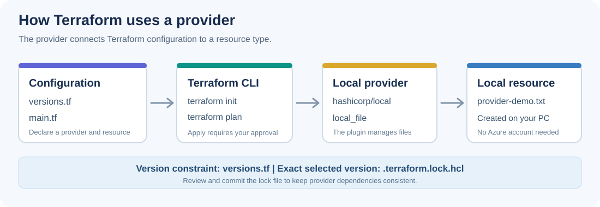

# 02. Providers

**Goal:** Understand what a Terraform provider does, how to declare it, and how to keep its version predictable.

**Estimated practice time:** 25 to 35 minutes  
**Prerequisites:** [Module 01](../01-what-is-terraform/README.md), Terraform installed, a terminal, and internet access for the first provider download.  
**Cloud account required:** No.

## 1. What is a provider?

Terraform describes **what you want**. A **provider** is a plugin that knows **how to work with a particular kind of resource**.

Think of it as a bridge:

- **Terraform configuration:** the instructions written in `.tf` files.
- **Provider:** the plugin that makes the relevant operations possible.
- **Resource:** the thing Terraform manages.

Providers exist for cloud platforms, services, and local resources. We use the `hashicorp/local` provider because it can create files on your own computer. There is no Azure setup in this module.



A provider is **not** the same as a resource: `hashicorp/local` is the provider, while `local_file` is one resource type it supports.

## 2. Declare the provider

Open [`example/versions.tf`](example/versions.tf):

```hcl
terraform {
  required_version = ">= 1.5.0"

  required_providers {
    local = {
      source  = "hashicorp/local"
      version = "~> 2.0"
    }
  }
}
```

| Setting | What it means |
| --- | --- |
| `required_version` | This example needs Terraform CLI version 1.5.0 or newer. |
| `local` | The short name used inside this configuration. |
| `source` | Where Terraform finds the provider: HashiCorp's `local` provider in the Terraform Registry. |
| `version` | The allowed provider versions. `~> 2.0` allows version 2.x, but not 3.x. |

**Why no `provider "local" {}` block?** The Local provider needs no extra configuration for this example. Terraform can use its default configuration. Other providers may require settings such as a region or an endpoint.

In [`example/main.tf`](example/main.tf), the resource starts with `local_file`:

```hcl
resource "local_file" "provider_demo" {
  content  = "This file was created through the Local provider.\n"
  filename = "${path.module}/provider-demo.txt"
}
```

Terraform determines which provider is responsible for this resource based on its resource type.

## 3. Two kinds of version control

A **version constraint** and a **dependency lock file** solve different problems:

- **`versions.tf`:** defines an acceptable range, for example any compatible 2.x release.
- **`.terraform.lock.hcl`:** records the **exact provider version** selected during `terraform init`, plus verification hashes.

On a fresh setup, `terraform init` installs a version that meets the constraint and writes a lock file. Later runs normally reuse that selection. This helps teammates work with the same provider version.

**Keep `.terraform.lock.hcl` in Git** when managing a real Terraform configuration. Do **not** commit `.terraform/`, state files, or secrets. The course examples may create a lock file locally when you initialize them.

`terraform init -upgrade` asks Terraform to consider newer provider versions within the allowed constraints. Use it deliberately and review the updated lock file before committing.

## 4. Guided lab: inspect and use a provider

**Start in the root of your cloned repository.** Type each command yourself.

### Step A: open the example

```sh
cd 02-providers/example
terraform version
```

Read `versions.tf` and find the provider's **local name**, **source**, and **version constraint**.

### Step B: initialize the provider

```sh
terraform init
```

Expected: Terraform downloads and initializes the Local provider. No `provider-demo.txt` file has been created yet.

Look for the generated `.terraform.lock.hcl` file. Find the exact provider version selected. This is different from the allowed range in `versions.tf`.

### Step C: inspect dependencies and preview changes

```sh
terraform providers
terraform fmt -check
terraform validate
terraform plan
```

Expected: `terraform providers` lists `registry.terraform.io/hashicorp/local`; validation succeeds; the plan proposes **1 to add**.

A plan is only a preview: the file does not exist yet.

### Step D: create the file manually

```sh
terraform apply
```

Read the displayed plan and type `yes` **only when you agree**. Open `provider-demo.txt` and confirm its content.

### Step E: observe a configuration change

In `main.tf`, change the sentence in `content` but keep the same filename.

```sh
terraform plan
```

Read the proposed change before you run `terraform apply` and confirm it manually. Inspect the updated file.

### Step F: clean up safely

```sh
terraform plan -destroy
terraform destroy
```

Check the destroy plan first; confirm `terraform destroy` manually. The managed text file should disappear. Terraform's local working files and state may remain and are excluded by the repository's root `.gitignore`.

> **From the field**
> In real projects, an unconstrained provider can behave differently after a new release.
> Set a version constraint and commit `.terraform.lock.hcl` to keep provider selection predictable.
> Review lock-file changes carefully before accepting a provider upgrade.

## 5. Independent challenge

Try [Challenge 02: One provider, two files](../exercises/02-providers/README.md). You will use the same provider for another resource, check the lock file, and preview the change before applying it.

## 6. Check your understanding

1. What is the difference between `hashicorp/local` and `local_file`?
2. Which file records the **exact** provider version selected by `terraform init`: `versions.tf` or `.terraform.lock.hcl`?
3. Why should you review a provider upgrade rather than update all providers without checking?

<details>
<summary>Show answers and explanations</summary>

1. **`hashicorp/local` is a provider**, which implements resource operations. **`local_file` is a resource type** exposed by that provider.
2. **`.terraform.lock.hcl`** records the selected version; `versions.tf` declares which versions are acceptable.
3. A new version may introduce behavior changes. **Controlled upgrades and review** help prevent unexpected changes to a working configuration.

</details>

## Troubleshooting

- **Provider download fails:** Check internet access and rerun `terraform init`.
- **Provider not installed:** Run `terraform init` before `validate` or `plan`.
- **The plan shows something unexpected:** Confirm you are in `02-providers/example` and inspect `main.tf`.
- **The file changed outside Terraform:** Read `terraform plan` carefully before applying anything.

## Further reading

- [Provider requirements](https://developer.hashicorp.com/terraform/language/providers/requirements)
- [Dependency lock file](https://developer.hashicorp.com/terraform/language/files/dependency-lock)
- [Local provider reference](https://registry.terraform.io/providers/hashicorp/local/latest/docs)

**Next:** [03. Terraform files](../03-tf-files/README.md), when published.
