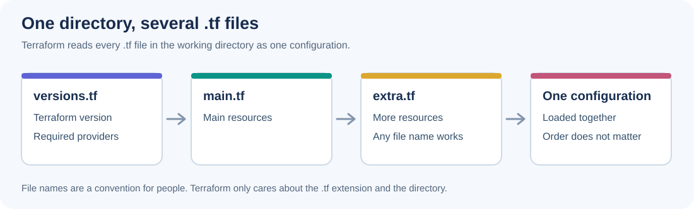

# 03. Terraform files

**Goal:** Know what each file in a Terraform directory is for, which ones you write, which ones Terraform creates, and which ones belong in Git.

**Estimated practice time:** 25 to 35 minutes  
**Prerequisites:** [Module 02](../02-providers/README.md), Terraform installed, and a terminal.  
**Cloud account required:** No.

## 1. One directory is one configuration

Terraform does not read one file. It reads **every `.tf` file in the working directory** and treats them as a single configuration.

Two consequences:

- You can split your code into as many `.tf` files as you like.
- **File names and file order do not matter to Terraform.** They matter to the people who read the code.



## 2. The files you write

Teams follow a naming convention so that anyone can find things quickly:

| File | What it usually contains | Covered in |
| --- | --- | --- |
| `versions.tf` | Required Terraform version and providers | [Module 02](../02-providers/README.md) |
| `main.tf` | The main resources | This module |
| `variables.tf` | Input variables | [Module 05](../05-variables-outputs/README.md) |
| `outputs.tf` | Output values | [Module 05](../05-variables-outputs/README.md) |
| `terraform.tfvars` | Values for the variables. Often private. | [Module 05](../05-variables-outputs/README.md) |

This is a convention, not a rule. A resource in `extra.tf` works exactly like a resource in `main.tf`.

## 3. The files Terraform creates

| File or folder | Created by | Commit to Git? | Why |
| --- | --- | --- | --- |
| `.terraform/` | `terraform init` | **No** | Downloaded providers. Large, and rebuilt by `init`. |
| `.terraform.lock.hcl` | `terraform init` | **Yes** | Records the exact provider versions. |
| `terraform.tfstate` | `terraform apply` | **No** | Terraform's record of what it manages. May contain sensitive data. See [module 04](../04-state/README.md). |
| `terraform.tfstate.backup` | `terraform apply` | **No** | The previous state. |

The repository's root `.gitignore` already excludes the files that must stay out of Git.

## 4. Guided lab: prove that file names do not matter

**Start in the root of your cloned repository.** Type each command yourself.

### Step A: read the example

```sh
cd 03-tf-files/example
ls
```

Open `versions.tf`, `main.tf`, and `extra.tf`. Count the resources: there are two, in two different files.

### Step B: initialize and preview

```sh
terraform init
terraform fmt -check
terraform validate
terraform plan
```

Expected: the plan proposes **2 to add**. Terraform found both resources, although they live in different files.

### Step C: apply and look at the new files

```sh
terraform apply
```

Read the plan and type `yes` only when you agree. Then list all files, including hidden ones (`ls -a` on macOS or Linux, `Get-ChildItem -Force` in PowerShell), and find: `.terraform/`, `.terraform.lock.hcl`, `terraform.tfstate`, and the two generated text files.

### Step D: move a resource to another file

1. Cut the whole `local_file.notes` block from `extra.tf`.
2. Paste it at the end of `main.tf`.
3. Delete the now empty `extra.tf`.

```sh
terraform plan
```

Expected: **No changes.** The resource has the same type and the same name, so for Terraform nothing happened. Only the layout of your code changed.

### Step E: rename a file

Rename `main.tf` to `resources.tf`, then run:

```sh
terraform plan
```

Expected: **No changes** again.

### Step F: see what Git would track

```sh
git status --short
```

Expected: your code changes and `.terraform.lock.hcl` appear. `.terraform/`, the state files, and the generated text files do not.

### Step G: clean up safely

```sh
terraform plan -destroy
terraform destroy
```

Check the destroy plan first; confirm manually. Then restore the example to its published layout:

```sh
git restore .
git status --short
```

If `resources.tf` is still listed as an untracked file, delete it: it is the copy you renamed in step E.

> **From the field**
> In a real project, nobody reads a 900-line `main.tf` with pleasure.
> Teams split code by purpose, for example `network.tf`, `storage.tf`, and `monitoring.tf`, and keep `versions.tf`, `variables.tf`, and `outputs.tf` in every directory.
> A newcomer then knows where to look before reading a single line.

## 5. Independent challenge

Try [Challenge 03: Tidy up one big file](../exercises/03-tf-files/README.md). You will split a single file into a clean layout and prove that Terraform sees no difference.

## 6. Check your understanding

1. You move a resource block from `main.tf` to `storage.tf` without changing it. What does `terraform plan` report?
2. Which of these belong in Git: `.terraform/`, `.terraform.lock.hcl`, `terraform.tfstate`?
3. Why do teams keep the same file names in every Terraform directory?

<details>
<summary>Show answers and explanations</summary>

1. **No changes.** Terraform identifies a resource by its type and name, not by the file that contains it.
2. **Only `.terraform.lock.hcl`.** The `.terraform/` folder is rebuilt by `terraform init`, and the state file can contain sensitive data.
3. **Predictability.** A shared convention lets anyone find variables, outputs, and provider versions without searching.

</details>

## Troubleshooting

- **`Duplicate resource` error:** the same resource type and name exist in two files. Remove one copy.
- **The plan shows a destroy after moving code:** the resource type or name changed during the move. Compare with the original block.
- **A file is ignored by Terraform:** check that it ends in `.tf` and sits in the working directory, not in a subfolder.

## Further reading

- [Files and directories](https://developer.hashicorp.com/terraform/language/files)
- [Style guide](https://developer.hashicorp.com/terraform/language/style)

**Next:** [04. State](../04-state/README.md)
