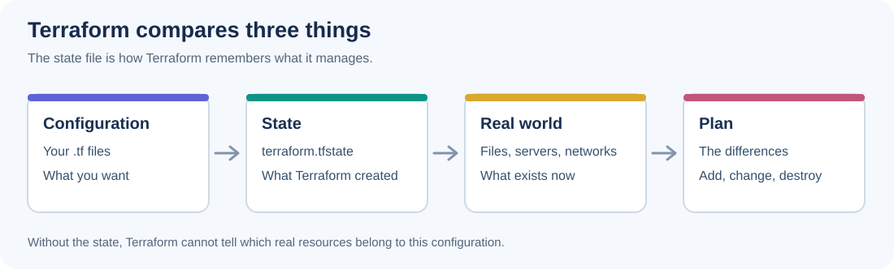

# 04. State

**Goal:** Understand why Terraform keeps a state file, read it safely, and see what happens when reality drifts away from it.

**Estimated practice time:** 30 to 40 minutes  
**Prerequisites:** [Module 03](../03-tf-files/README.md), Terraform installed, and a terminal.  
**Cloud account required:** No.

## 1. Why Terraform needs a memory

Your `.tf` files describe what you **want**. They do not say what Terraform has **already created**.

Terraform writes that information in a **state file**, named `terraform.tfstate` by default. On every `plan`, Terraform compares three things:

- the **configuration**: what you want;
- the **state**: what Terraform believes it manages;
- the **real world**: what actually exists.



The plan is the list of differences. No state means no memory: Terraform would treat every resource as new.

## 2. What the state contains

The state is a JSON file. For each resource it stores the resource type, its name, and every attribute, including values that only exist after creation.

Three rules follow from this:

| Rule | Reason |
| --- | --- |
| **Never commit the state to Git.** | It can contain passwords, keys, and other sensitive values in clear text. |
| **Never edit the state by hand.** | One wrong character can make Terraform lose track of real resources. Use `terraform state` commands instead. |
| **Protect and back up the state.** | Losing it does not delete your resources, but Terraform no longer knows they are yours. |

In a team, the state does not live on one laptop. It is stored in a shared, locked place called a **remote backend**, for example an Azure storage account. You will not need one in this course.

## 3. Guided lab: read the state and cause a drift

**Start in the root of your cloned repository.** Type each command yourself.

### Step A: create the resources

```sh
cd 04-state/example
terraform init
terraform plan
terraform apply
```

Expected: the plan proposes **2 to add**. Confirm the apply after reading it.

### Step B: ask Terraform what it manages

```sh
terraform state list
```

Expected:

```text
local_file.inventory
local_file.owner
```

These are **resource addresses**: the resource type, a dot, and the name you chose.

### Step C: inspect one resource

```sh
terraform state show local_file.inventory
```

Expected: the attributes of the file, such as `filename`, `content`, and several computed hashes that are not in your `.tf` file. Terraform learned them when it created the file.

### Step D: look at the raw file, without editing it

Open `terraform.tfstate` in a text editor in **read-only** fashion. Find the `resources` list and the `serial` number. Close the file without saving.

### Step E: cause a drift

Delete one generated file by hand, outside Terraform:

```sh
rm state-owner.txt
```

In PowerShell, use `Remove-Item state-owner.txt`.

```sh
terraform plan
```

Expected: the plan proposes **1 to add**. Terraform compared its state with reality, saw that the file is gone, and offers to create it again. This difference between state and reality is called **drift**.

### Step F: repair

```sh
terraform apply
terraform plan
```

Confirm the apply after reading the plan. Expected on the second command: **No changes.**

### Step G: notice the serial number

Open `terraform.tfstate` again, read-only: the `serial` number has increased. Terraform raises it every time it writes a new version of the state.

### Step H: clean up safely

```sh
terraform plan -destroy
terraform destroy
terraform state list
```

Check the destroy plan first; confirm manually. Expected on the last command: nothing is listed. The state file still exists, but it is empty of resources.

List the directory: Terraform now also keeps `terraform.tfstate.backup`, the previous version of the state. Depending on the operations you ran, this file may appear only after some of them, such as `destroy`.

> **From the field**
> A lost state file is one of the classic Terraform incidents.
> The resources keep running, but Terraform no longer knows them, so the next `apply` tries to create everything a second time.
> Before any risky operation, make a copy of the state and compare the two files with a checksum.

## 4. Independent challenge

Try [Challenge 04: Lose the state, then get it back](../exercises/04-state/README.md). You will simulate a lost state file in a safe way and recover from it.

## 5. Check your understanding

1. You delete a managed file by hand. What does the next `terraform plan` propose, and why?
2. Why must the state file stay out of Git?
3. Your state file is lost, but the resources still exist. What would the next `terraform plan` show?

<details>
<summary>Show answers and explanations</summary>

1. **It proposes to create the file again.** The state says the file should exist, reality says it does not, and the configuration still declares it.
2. **It can contain sensitive values in clear text**, and it changes on every apply, which causes conflicts between teammates.
3. **It would propose to create every resource**, because without state Terraform has no record that it already manages them.

</details>

## Troubleshooting

- **`No state file was found`:** you are in the wrong directory, or nothing has been applied yet.
- **`Error acquiring the state lock`:** another Terraform command is still running in this directory. Wait for it to finish.
- **The plan shows changes you did not make:** something changed outside Terraform. Read the plan before applying.

## Further reading

- [State](https://developer.hashicorp.com/terraform/language/state)
- [Purpose of Terraform state](https://developer.hashicorp.com/terraform/language/state/purpose)
- [Sensitive data in state](https://developer.hashicorp.com/terraform/language/state/sensitive-data)

**Next:** [05. Variables and outputs](../05-variables-outputs/README.md)
