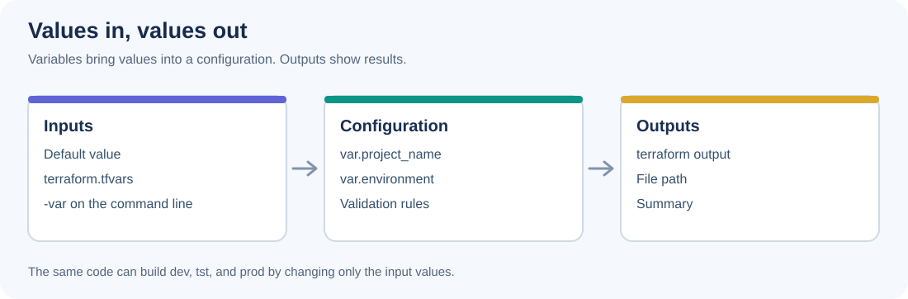

# 05. Variables and outputs

**Goal:** Make a configuration reusable with input variables, protect it with validation rules, and read results with outputs.

**Estimated practice time:** 35 to 45 minutes  
**Prerequisites:** [Module 04](../04-state/README.md), Terraform installed, and a terminal.  
**Cloud account required:** No.

## 1. Why variables?

So far, every value was written directly in `main.tf`. To build the same thing for another project or another environment, you would have to copy the code and edit it.

A **variable** is a named input. The code stays the same; only the values change.



## 2. Declare a variable

Open [`example/variables.tf`](example/variables.tf):

```hcl
variable "environment" {
  description = "Environment name. Allowed values: dev, tst, prod."
  type        = string
  default     = "dev"

  validation {
    condition     = contains(["dev", "tst", "prod"], var.environment)
    error_message = "environment must be one of: dev, tst, prod."
  }
}
```

| Setting | What it means |
| --- | --- |
| `description` | Explains the variable to the next reader. Always write one. |
| `type` | The kind of value: `string`, `number`, `bool`, `list(string)`, `map(string)`, and more. |
| `default` | The value used when none is given. Without a default, Terraform asks for a value. |
| `validation` | A rule the value must satisfy, with a clear error message. |

You use a variable with `var.` followed by its name, for example `var.environment`.

## 3. Give a variable a value

There are several ways. From lowest to highest priority:

| Method | Example | Typical use |
| --- | --- | --- |
| Default in `variables.tf` | `default = "dev"` | A sensible fallback |
| `terraform.tfvars` file | `environment = "tst"` | Values for one environment |
| Command line | `-var="environment=prod"` | A one-off override |

When the same variable is set in several places, the highest priority wins.

**About `terraform.tfvars`:** real projects often put private values in it, so this repository's `.gitignore` excludes every `*.tfvars` file. The example provides `terraform.tfvars.example` instead: a safe template you copy and edit.

## 4. Outputs

An **output** shows a value after `terraform apply`. Open [`example/outputs.tf`](example/outputs.tf):

```hcl
output "file_path" {
  description = "Path of the generated summary file."
  value       = local_file.summary.filename
}
```

Outputs answer the question "what did I just build, and where is it?". Other tools, and other Terraform configurations, can read them too.

## 5. Guided lab: one configuration, several results

**Start in the root of your cloned repository.** Type each command yourself.

### Step A: use the defaults

```sh
cd 05-variables-outputs/example
terraform init
terraform validate
terraform plan
```

Expected: **1 to add**, a file named `demo-dev.txt`. The plan also lists `Changes to Outputs`.

```sh
terraform apply
terraform output
```

Confirm the apply after reading the plan. Expected: two outputs, `file_path` and `summary`.

### Step B: override on the command line

```sh
terraform plan -var="environment=tst"
```

Expected: the plan wants to **replace** the file: `demo-dev.txt` is destroyed and `demo-tst.txt` is created. A different file name is a different file. Do not apply; this was only a preview.

### Step C: trigger the validation rule

```sh
terraform plan -var="environment=production"
```

Expected: an error, `environment must be one of: dev, tst, prod.` Nothing is planned. The rule stopped a typo before it could create anything.

### Step D: use a variable file

Copy the template, then plan without any `-var` option:

```sh
cp terraform.tfvars.example terraform.tfvars
terraform plan
```

In PowerShell, use `Copy-Item terraform.tfvars.example terraform.tfvars`.

Expected: Terraform reads `terraform.tfvars` automatically. The plan replaces `demo-dev.txt` with `webshop-tst.txt` and the summary shows a team of 3.

### Step E: apply and read one output

```sh
terraform apply
terraform output -raw file_path
```

Confirm after reading the plan. The second command prints only the path, without quotes. This form is handy in scripts.

### Step F: check what Git sees

```sh
git status --short
```

Expected: `terraform.tfvars` is **not** listed. `.terraform.lock.hcl` may be.

### Step G: clean up safely

```sh
terraform plan -destroy
terraform destroy
```

Check the destroy plan first; confirm manually. Then delete your `terraform.tfvars`.

> **From the field**
> The same Terraform code usually serves several environments, with one variable file per environment.
> A validation rule costs three lines and saves the hour spent finding out why a resource was created in an environment called `prd` instead of `prod`.
> Treat variable files that hold real values like passwords: keep them out of Git.

## 6. Independent challenge

Try [Challenge 05: A configurable greeting](../exercises/05-variables-outputs/README.md). You will add a variable with its own validation rule and a new output.

## 7. Check your understanding

1. A variable has `default = "dev"`, `terraform.tfvars` sets it to `tst`, and you run `terraform plan -var="environment=prod"`. Which value is used?
2. What is the difference between a variable and an output?
3. Why does this repository ship `terraform.tfvars.example` and not `terraform.tfvars`?

<details>
<summary>Show answers and explanations</summary>

1. **`prod`.** A command-line value overrides a variable file, which overrides the default.
2. **A variable is an input**: a value that goes into the configuration. **An output is a result**: a value Terraform shows after apply.
3. **`*.tfvars` files are ignored by Git** because they often contain private values. The `.example` file is a safe template.

</details>

## Troubleshooting

- **Terraform asks you to type a value:** the variable has no default and no value was provided. Add one of the two.
- **`Invalid value for variable`:** a validation rule rejected the value. Read the error message.
- **`Reference to undeclared input variable`:** you used `var.something` without a matching `variable` block.
- **Your variable file is ignored:** only files named `terraform.tfvars` or ending in `.auto.tfvars` load automatically. Use `-var-file` for other names.

## Further reading

- [Input variables](https://developer.hashicorp.com/terraform/language/values/variables)
- [Output values](https://developer.hashicorp.com/terraform/language/values/outputs)
- [Variable definition precedence](https://developer.hashicorp.com/terraform/language/values/variables#variable-definition-precedence)

**Next:** [06. Modules](../06-modules/README.md)
