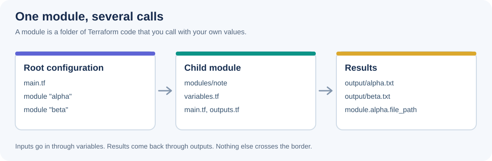

# 06. Modules

**Goal:** Package Terraform code as a module, call it twice with different values, and read its results.

**Estimated practice time:** 40 to 50 minutes  
**Prerequisites:** [Module 05](../05-variables-outputs/README.md), Terraform installed, and a terminal.  
**Cloud account required:** No.

## 1. What is a module?

A **module** is a folder that contains Terraform files. That is all.

You have been writing modules since module 01: the folder where you run `terraform` is the **root module**, also called the root configuration. A **child module** is another folder that the root calls with a `module` block.

Think of a child module as a function in a programming language:

| Function | Module |
| --- | --- |
| Parameters | Input variables |
| Body | Resources |
| Return values | Outputs |
| Function call | `module` block |



## 2. Why use modules?

- **Write once, use many times.** The same code builds several similar things.
- **One place to fix a mistake.** Correct the module and every caller benefits.
- **A clear contract.** Callers only see inputs and outputs, not the details inside.

## 3. Read the child module

Open the folder [`example/modules/note`](example/modules/note). It has the files you already know from module 03:

| File | Role in the module |
| --- | --- |
| `variables.tf` | The inputs: `name`, `filename`, `lines` |
| `main.tf` | One `local_file` resource built from the inputs |
| `outputs.tf` | The results: `file_path`, `line_count` |
| `versions.tf` | The provider the module needs |

Notice what is **not** there: no file path is fixed inside the module. The caller passes `filename`. A module that decides its own file name could only be called once, because two calls would fight over the same file.

## 4. Read the calls

Open [`example/main.tf`](example/main.tf):

```hcl
module "alpha" {
  source = "./modules/note"

  name     = "alpha"
  filename = "${path.root}/output/alpha.txt"
  lines    = ["First call of the module."]
}
```

- `source` says where the module code lives. Here it is a local folder.
- The other arguments are the module's input variables.
- `path.root` is the folder of the root configuration.

To read a result, use `module.<call name>.<output name>`, for example `module.alpha.file_path`.

## 5. Guided lab: call one module twice

**Start in the root of your cloned repository.** Type each command yourself.

### Step A: initialize

```sh
cd 06-modules/example
terraform init
```

Expected: a line `Initializing modules...` listing `alpha` and `beta`. Terraform must run `init` again every time you add a module call or change a `source`.

### Step B: validate and plan

```sh
terraform fmt -check -recursive
terraform validate
terraform plan
```

Expected: **2 to add**. Read the addresses: `module.alpha.local_file.this` and `module.beta.local_file.this`. The same resource block appears twice, once per call.

### Step C: apply and read the outputs

```sh
terraform apply
terraform output
```

Confirm after reading the plan. Expected: `note_paths` lists two files and `total_lines` is `3`.

### Step D: look inside the state

```sh
terraform state list
```

Expected: two addresses, each starting with `module.`.

### Step E: break the contract on purpose

In `main.tf`, add this line inside the `alpha` call, then validate:

```hcl
  color = "blue"
```

```sh
terraform validate
```

Expected: `Unsupported argument`. The module has no variable named `color`. Remove the line and validate again.

### Step F: change the module, see both calls change

In `modules/note/main.tf`, change `"# Note: ${var.name}"` to `"# Project note: ${var.name}"`, then:

```sh
terraform plan
```

Expected: **2 to add, 2 to destroy**. One edit in the module changes every caller. This is the strength of a module, and the reason to change shared modules with care. Undo the edit; do not apply.

### Step G: clean up safely

```sh
terraform plan -destroy
terraform destroy
```

Check the destroy plan first; confirm manually. Then run `git status --short` and `git restore .` if a file is still modified.

> **From the field**
> Teams keep shared modules for the things they build again and again: a network, a storage account, a naming rule.
> A good module is small and has few inputs. If a module needs forty variables, it is usually doing too much.
> Once other people call your module, every change to its inputs is a change to their code. Module 08 and 09 show how Git helps you manage such changes.

## 6. Independent challenge

Try [Challenge 06: A third note and a new input](../exercises/06-modules/README.md). You will add a module call and extend the module without breaking the existing callers.

## 7. Check your understanding

1. What is the difference between the root module and a child module?
2. The root configuration needs the path of the file created by the `beta` call. How does it get it?
3. Why does the `note` module receive `filename` as an input and not build the path itself?

<details>
<summary>Show answers and explanations</summary>

1. **The root module is the folder where you run Terraform.** A child module is a folder called from another module with a `module` block.
2. **Through an output:** `module.beta.file_path`. Resources inside a module are not directly visible from outside.
3. **So that it can be called several times.** With a fixed path, two calls would manage the same file and conflict.

</details>

## Troubleshooting

- **`Module not installed`:** you added or changed a module call. Run `terraform init`.
- **`Unsupported argument`:** the argument is not an input variable of the module. Compare with its `variables.tf`.
- **`Missing required argument`:** the module has a variable without a default and the call does not set it.
- **`Unsupported attribute` on `module.alpha`:** the value is not declared in the module's `outputs.tf`.

## Further reading

- [Modules overview](https://developer.hashicorp.com/terraform/language/modules)
- [Module blocks](https://developer.hashicorp.com/terraform/language/modules/syntax)
- [Creating modules](https://developer.hashicorp.com/terraform/language/modules/develop)

**Next:** [07. Essential commands](../07-essential-commands/README.md)
