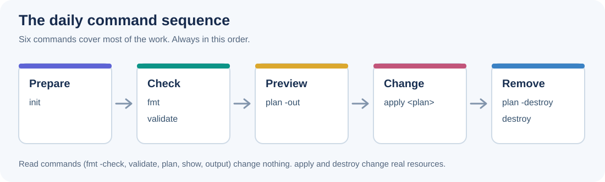

# 07. Essential commands

**Goal:** Use the daily Terraform commands in the right order, save a plan, and apply exactly what you reviewed.

**Estimated practice time:** 35 to 45 minutes  
**Prerequisites:** [Module 06](../06-modules/README.md), Terraform installed, and a terminal.  
**Cloud account required:** No.

## 1. Six commands, one order

You have already typed most of these commands. This module puts them in order and explains what each one may change.



| Command | What it does | Changes real resources? |
| --- | --- | --- |
| `terraform init` | Downloads providers and modules, prepares the folder | No |
| `terraform fmt` | Rewrites `.tf` files with standard formatting | No (only your files) |
| `terraform validate` | Checks syntax and internal consistency | No |
| `terraform plan` | Shows what would change | No |
| `terraform apply` | Makes the changes | **Yes** |
| `terraform destroy` | Removes everything in the state | **Yes** |

## 2. Useful options

| Option | Purpose |
| --- | --- |
| `fmt -check` | Reports badly formatted files without rewriting them. Used in automated checks. |
| `fmt -recursive` | Also formats subfolders, such as modules. |
| `plan -out=FILE` | Saves the plan to a file. |
| `apply FILE` | Applies a saved plan, without asking again. |
| `show FILE` | Displays a saved plan. |
| `plan -destroy` | Previews a destroy without doing it. |
| `output` | Prints the outputs stored in the state. |

## 3. Why save a plan?

Without a saved plan, `terraform apply` computes a **new** plan and asks for confirmation. If something changed between your `plan` and your `apply`, you approve something you did not read.

With `plan -out`, Terraform applies **exactly** the reviewed plan. If the state changed in the meantime, Terraform refuses the stale plan.

A saved plan can contain sensitive values. Never commit it. This repository ignores files ending in `.tfplan`.

## 4. Guided lab: the full sequence

**Start in the root of your cloned repository.** Type each command yourself.

### Step A: initialize

```sh
cd 07-essential-commands/example
terraform init
```

### Step B: check, then fix, the formatting

```sh
terraform fmt -check
```

Expected: the command prints `main.tf` and returns an error code. The file is valid but badly formatted. Now see the difference and repair it:

```sh
terraform fmt -diff
terraform fmt -check
```

Expected: the first command shows the corrected lines and rewrites the file. The second prints nothing: the folder is clean.

### Step C: validate

```sh
terraform validate
```

Expected: `Success! The configuration is valid.`

### Step D: save a plan and read it

```sh
terraform plan -out=demo.tfplan
terraform show demo.tfplan
```

Expected: **1 to add**. `show` displays the same plan again, from the file.

### Step E: apply the saved plan

```sh
terraform apply demo.tfplan
terraform output
```

Expected: no confirmation question, because the plan was already reviewed. `Apply complete! Resources: 1 added`.

### Step F: try to reuse the plan

```sh
terraform apply demo.tfplan
```

Expected: an error, `Saved plan is stale`. The state changed since the plan was created, so Terraform refuses it. This protection is the reason saved plans exist.

### Step G: plan a change with a variable

```sh
terraform plan -var="release=1.1" -out=demo.tfplan
terraform apply demo.tfplan
```

Expected: the plan replaces the file, because its content changed. Open `release-note.txt` to confirm.

### Step H: clean up safely

```sh
terraform plan -destroy
terraform destroy
git status --short
```

Check the destroy plan first; confirm manually. Then delete `demo.tfplan` and run `git restore .` to bring back the badly formatted file for the next learner.

> **From the field**
> In automated pipelines, the plan is saved during review and the same file is applied after approval. Nobody applies a plan that nobody read.
> `terraform fmt -check` and `terraform validate` run on every pull request in most teams. They cost seconds and stop the most common mistakes.
> `terraform destroy` has no undo. In shared environments, most teams restrict who can run it.

## 5. Quick reference

| I want to... | Command |
| --- | --- |
| Start in a new folder | `terraform init` |
| Clean up formatting | `terraform fmt -recursive` |
| Find mistakes early | `terraform validate` |
| See what would change | `terraform plan` |
| Apply exactly what I reviewed | `terraform plan -out=FILE` then `terraform apply FILE` |
| See what Terraform manages | `terraform state list` |
| Read results | `terraform output` |
| Preview a removal | `terraform plan -destroy` |

## 6. Independent challenge

Try [Challenge 07: Find the errors](../exercises/07-essential-commands/README.md). You will repair a broken configuration using only the commands of this module.

## 7. Check your understanding

1. Which commands in this module change real resources?
2. What is the difference between `terraform apply` and `terraform apply demo.tfplan`?
3. `terraform fmt -check` fails but `terraform validate` succeeds. What does that tell you?

<details>
<summary>Show answers and explanations</summary>

1. **`apply` and `destroy`.** The others only read, check, or rewrite your own `.tf` files.
2. **Without a file, Terraform creates a new plan and asks for confirmation.** With a saved plan, it applies exactly that plan, without asking, and refuses it if it is stale.
3. **The code is correct but not formatted in the standard way.** Run `terraform fmt` to fix it.

</details>

## Troubleshooting

- **`Saved plan is stale`:** create a new plan with `terraform plan -out`.
- **`Inconsistent dependency lock file` or `Module not installed`:** run `terraform init`.
- **`fmt` reports a syntax error:** the file cannot be parsed at all. Read the line number, fix it, and run `fmt` again.
- **The plan file appears in `git status`:** its name does not end in `.tfplan`. Delete it and use the `.tfplan` extension.

## Further reading

- [Terraform CLI commands](https://developer.hashicorp.com/terraform/cli/commands)
- [terraform plan](https://developer.hashicorp.com/terraform/cli/commands/plan)
- [terraform apply](https://developer.hashicorp.com/terraform/cli/commands/apply)
- [terraform fmt](https://developer.hashicorp.com/terraform/cli/commands/fmt)

**Next:** [08. Git basics](../08-git-basics/README.md)
