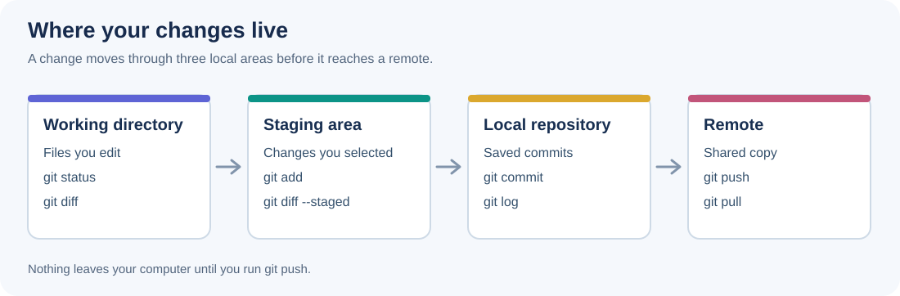

# 08. Git basics

**Goal:** Create a Git repository, save your work as commits, read the history, and keep sensitive Terraform files out of it.

**Estimated practice time:** 40 to 50 minutes  
**Prerequisites:** [Module 07](../07-essential-commands/README.md), Git installed, and a terminal.  
**Cloud account required:** No. A GitHub account is only needed for the optional last step.

## 1. Why Git with Terraform?

Terraform code describes real infrastructure. You want to know **who changed what, when, and why**, and to be able to go back.

**Git** records the history of a folder. Each saved point is a **commit**. **GitHub** is a website that hosts Git repositories so that a team can share them. Git works without GitHub; GitHub does not work without Git.

## 2. Three areas, then a remote



| Area | What it holds | Command to move forward |
| --- | --- | --- |
| Working directory | The files as you see and edit them | `git add` |
| Staging area | The changes selected for the next commit | `git commit` |
| Local repository | The saved commits, on your computer | `git push` |
| Remote | A shared copy, for example on GitHub | |

The staging area lets you choose. You may have edited five files and want to commit only two of them.

## 3. Commands of this module

| Command | Purpose |
| --- | --- |
| `git init` | Turn a folder into a repository |
| `git status` | Show what changed and what is staged |
| `git add FILE` | Stage a file |
| `git commit -m "message"` | Save the staged changes as a commit |
| `git log --oneline` | Show the history, one line per commit |
| `git diff` | Show changes that are not staged yet |
| `git diff --staged` | Show changes that are staged |
| `git restore FILE` | Throw away unstaged changes in a file |
| `git restore --staged FILE` | Unstage a file, keeping your edits |

## 4. What never goes into Git

| File | Why it stays out |
| --- | --- |
| `terraform.tfstate` and backups | Can contain passwords and keys in clear text |
| `.terraform/` | Downloaded providers: large and re-creatable with `terraform init` |
| `*.tfvars` | Often hold private values |
| Saved plan files | Can contain sensitive values |

A file named `.gitignore` lists what Git must ignore. One file **does** belong in Git: `.terraform.lock.hcl`, which records the provider versions.

A commit is permanent. Removing a secret in a later commit does not remove it from the history. If a secret is ever committed, treat it as exposed and replace it.

## 5. Guided lab: your first repository

You will work in a **separate sandbox folder**, outside your clone of this course. That way you can experiment freely.

### Step A: introduce yourself to Git (once per computer)

```sh
git config --global user.name
git config --global user.email
```

If either command prints nothing, set the value:

```sh
git config --global user.name "Your Name"
git config --global user.email "you@example.com"
```

Every commit carries this name and address. On GitHub you can use a private `noreply` address; see **Further reading**.

### Step B: create the sandbox

Start in the root of your cloned course repository:

```sh
mkdir ../git-sandbox
cp 08-git-basics/example/main.tf ../git-sandbox/main.tf
cp 08-git-basics/example/gitignore-template.txt ../git-sandbox/.gitignore
cd ../git-sandbox
git init -b main
```

In PowerShell, `mkdir` and `cp` work the same way.

Expected: `Initialized empty Git repository`. The option `-b main` names the first branch `main`.

### Step C: look before you save

```sh
git status
```

Expected: two **untracked** files, `.gitignore` and `main.tf`. Untracked means Git sees the file but does not record it yet.

### Step D: stage and commit

```sh
git add .gitignore main.tf
git status
git commit -m "Add first Terraform file and ignore rules"
git log --oneline
```

Expected: after `git add`, the files appear under `Changes to be committed`. After the commit, the log shows one line.

### Step E: change, compare, commit

Open `main.tf` and change the text `Hello from my first repository.` to `Hello from Git.`. Then:

```sh
git status
git diff
git add main.tf
git diff --staged
git commit -m "Change the greeting text"
git log --oneline
```

Expected: `git diff` shows one red line (removed) and one green line (added). The log now shows two commits.

### Step F: check that ignore rules work

Create two files that must never be committed:

```sh
echo "fake state" > terraform.tfstate
echo "secret = 1" > private.tfvars
git status
```

Expected: `nothing to commit, working tree clean`. Both files exist, but Git ignores them. Delete them afterwards.

### Step G: undo a mistake

Open `main.tf`, delete a few lines by mistake on purpose, and save. Then:

```sh
git status
git restore main.tf
git status
```

Expected: the file is back to its last committed version. `git restore` discards your unstaged edits for good, so read `git diff` before using it.

### Step H (optional): publish to GitHub

1. On GitHub, create a new **private**, **empty** repository named `git-sandbox` (no README, no `.gitignore`).
2. Copy the two commands GitHub displays under **push an existing repository**. They look like this:

```sh
git remote add origin https://github.com/YOUR-ACCOUNT/git-sandbox.git
git push -u origin main
```

Expected: your two commits are visible on GitHub. From now on, `git push` sends new commits and `git pull` fetches the ones made elsewhere.

Keep the sandbox: module 09 uses it.

> **From the field**
> Teams read the Git history during incidents: "what changed yesterday?" is usually the first question. Small commits with clear messages answer it in seconds.
> A good message completes the sentence "This commit will...": `Add storage account for logs`, not `update` or `fix`.
> The most expensive Git mistake in infrastructure work is a committed secret or state file. Set up `.gitignore` before the first commit, not after.

## 6. Independent challenge

Try [Challenge 08: Three clean commits](../exercises/08-git-basics/README.md). You will build a short, readable history and rescue a file that was staged by mistake.

## 7. Check your understanding

1. What is the difference between `git add` and `git commit`?
2. You committed a password yesterday and removed it in a new commit today. Is the password safe?
3. Which Terraform file should be committed although it is generated by `terraform init`?

<details>
<summary>Show answers and explanations</summary>

1. **`git add` selects changes for the next commit** (staging). **`git commit` saves the selected changes** in the history.
2. **No.** The old commit still contains it. Consider the password exposed and replace it.
3. **`.terraform.lock.hcl`.** It records the exact provider versions so everyone uses the same ones.

</details>

## Troubleshooting

- **`Author identity unknown`:** run the two `git config --global` commands of Step A.
- **`fatal: not a git repository`:** you are not in the sandbox folder, or `git init` was not run.
- **A file that should be ignored appears in `git status`:** check the spelling in `.gitignore`, and that the file is really named `.gitignore`.
- **A file was committed before being ignored:** `.gitignore` only affects untracked files. Run `git rm --cached FILE`, then commit.
- **`git init -b main` is not recognized:** your Git version is old. Run `git init`, then `git branch -M main`.
- **`git push` asks you to sign in:** a browser window opens for GitHub. This is expected the first time.

## Further reading

- [Git documentation](https://git-scm.com/doc)
- [About Git (GitHub Docs)](https://docs.github.com/en/get-started/using-git/about-git)
- [Ignoring files (GitHub Docs)](https://docs.github.com/en/get-started/getting-started-with-git/ignoring-files)
- [Setting your commit email address (GitHub Docs)](https://docs.github.com/en/account-and-profile/setting-up-and-managing-your-personal-account-on-github/managing-email-preferences/setting-your-commit-email-address)

**Next:** [09. Branches and pull requests](../09-branches-pull-requests/README.md)
