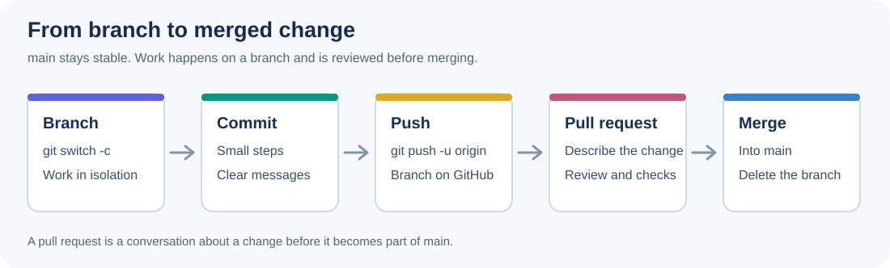

# 09. Branches and pull requests

**Goal:** Work on a branch, solve a simple conflict, and propose a change through a pull request.

**Estimated practice time:** 45 to 60 minutes  
**Prerequisites:** [Module 08](../08-git-basics/README.md) and the `git-sandbox` repository you created there.  
**Cloud account required:** No. A GitHub account is needed for Part 2 only.

## 1. Why branches?

`main` is the version everyone trusts. In infrastructure work, `main` usually describes what is really deployed.

A **branch** is a separate line of work. You can try, break, and fix things on a branch while `main` stays stable. When the work is ready, it is **merged** into `main`.



## 2. What is a pull request?

A **pull request**, often shortened to PR (pull request), is a GitHub page that says: "here is my branch, please review it before it joins `main`".

It shows the exact differences, lets other people comment, and can run automatic checks. Nothing is merged until someone decides to.

## 3. Commands of this module

| Command | Purpose |
| --- | --- |
| `git branch` | List branches; the current one is marked with `*` |
| `git switch -c NAME` | Create a branch and move to it |
| `git switch NAME` | Move to an existing branch |
| `git merge NAME` | Bring the commits of `NAME` into the current branch |
| `git branch -d NAME` | Delete a branch that has been merged |
| `git push -u origin NAME` | Publish a branch to GitHub |
| `git pull` | Fetch and integrate the remote changes |

Name branches after their purpose: `feature/add-tags`, `fix/typo-in-readme`, `docs/update-usage`.

## 4. Guided lab, Part 1: branch, merge, conflict (local)

Work in your `git-sandbox` folder. Check first that everything is committed:

```sh
git status
git branch
```

Expected: a clean working tree and one branch, `main`.

### Step A: create a branch and commit on it

```sh
git switch -c feature/add-farewell
```

Add this block at the end of `main.tf`, then save:

```hcl
resource "local_file" "farewell" {
  filename = "${path.module}/farewell.txt"
  content  = "Goodbye from a branch.\n"
}
```

```sh
git add main.tf
git commit -m "Add farewell file resource"
git log --oneline
```

### Step B: see that main did not move

```sh
git switch main
```

Open `main.tf`: the `farewell` block is gone. It is not lost; it lives on the other branch. Each branch has its own version of the files.

### Step C: merge

```sh
git merge feature/add-farewell
git log --oneline
git branch -d feature/add-farewell
```

Expected: `Fast-forward`. `main` now contains the new commit and the branch is deleted.

### Step D: create a conflict on purpose

A conflict happens when two branches change **the same lines**. Create one:

```sh
git switch -c feature/polite-greeting
```

In `main.tf`, change the `content` line of the `hello` resource to `"Good morning.\n"`. Then:

```sh
git add main.tf
git commit -m "Use a polite greeting"
git switch main
```

Now, on `main`, change **the same line** to `"Hi there.\n"`. Then:

```sh
git add main.tf
git commit -m "Use a short greeting"
git merge feature/polite-greeting
```

Expected: `CONFLICT (content): Merge conflict in main.tf`. Git stops and asks you to decide.

### Step E: resolve the conflict

```sh
git status
```

Open `main.tf`. Git marked the two versions:

```text
<<<<<<< HEAD
  content  = "Hi there.\n"
=======
  content  = "Good morning.\n"
>>>>>>> feature/polite-greeting
```

- Between `<<<<<<< HEAD` and `=======`: the version of your current branch (`main`).
- Between `=======` and `>>>>>>>`: the version of the branch being merged.

Edit the file so that only the line you want remains, and delete the three marker lines. Then:

```sh
git add main.tf
git commit -m "Merge polite greeting, keep one greeting line"
git log --oneline --graph
git branch -d feature/polite-greeting
```

Expected: the graph shows two lines joining. The conflict is solved.

If you feel lost during a conflict, `git merge --abort` returns to the state before the merge. Nothing is broken.

## 5. Guided lab, Part 2: a pull request (GitHub)

This part needs the private `git-sandbox` repository on GitHub from module 08, Step H.

### Step F: publish main, then a new branch

```sh
git push
git switch -c docs/add-readme
```

Create a `README.md` with a title and one sentence, or edit yours if it exists. Then:

```sh
git add README.md
git commit -m "Describe the sandbox in the README"
git push -u origin docs/add-readme
```

### Step G: open the pull request

1. Open your repository on GitHub. A banner proposes **Compare & pull request**. Select it.
2. Check the direction: **base: `main`**, **compare: `docs/add-readme`**.
3. Write a title and a description: what changes, and why. The file [`example/pull-request-template.md`](example/pull-request-template.md) shows a useful structure.
4. Select **Create pull request**.

### Step H: review and merge

1. Open the **Files changed** tab. Read every line, as a reviewer would.
2. Go back to **Conversation** and select **Merge pull request**, then **Confirm merge**.
3. Select **Delete branch**.

### Step I: bring your computer up to date

```sh
git switch main
git pull
git branch -d docs/add-readme
git log --oneline
```

Expected: your local `main` contains the merged change, and the local branch is deleted.

> **From the field**
> In most teams nobody pushes to `main`. A rule on the repository requires a pull request, at least one approval, and passing checks.
> For Terraform, the checks usually run `fmt`, `validate`, and `plan`. The reviewer reads the code **and** the plan: "3 to destroy" in a change that only claims to add a tag is a reason to stop.
> Short-lived branches cause fewer conflicts. A branch open for three weeks is a conflict waiting to happen.

## 6. Independent challenge

Try [Challenge 09: Two branches, one file](../exercises/09-branches-pull-requests/README.md). You will handle two branches, one of which conflicts, and finish with a clean history.

## 7. Check your understanding

1. Why not commit directly on `main`?
2. What causes a merge conflict?
3. In a pull request, what do **base** and **compare** mean?

<details>
<summary>Show answers and explanations</summary>

1. **`main` must stay stable and reviewed.** A branch isolates work in progress, and a pull request lets someone check it before it joins `main`.
2. **Two branches changed the same lines in different ways.** Git cannot choose for you.
3. **Base is the branch that receives the change** (usually `main`). **Compare is the branch that contains your work.**

</details>

## Troubleshooting

- **`error: Your local changes would be overwritten`:** commit your changes before switching branches.
- **`fatal: The current branch has no upstream branch`:** use `git push -u origin BRANCH-NAME` the first time.
- **`error: The branch is not fully merged`:** Git protects unmerged work. Merge it first, or check that you really want to drop it.
- **The pull request shows unexpected files:** the branch was created from the wrong starting point. Compare base and compare, and ask before merging.
- **A conflict looks confusing:** run `git merge --abort`, read both versions calmly, and try again.

## What comes next

You finished the fundamentals. Continue with real Azure resources in the [azure-terraform-devops-lab](https://github.com/Solisys-Cloud/azure-terraform-devops-lab) repository.

## Further reading

- [About branches (GitHub Docs)](https://docs.github.com/en/pull-requests/collaborating-with-pull-requests/proposing-changes-to-your-work-with-pull-requests/about-branches)
- [About pull requests (GitHub Docs)](https://docs.github.com/en/pull-requests/collaborating-with-pull-requests/proposing-changes-to-your-work-with-pull-requests/about-pull-requests)
- [Resolving a merge conflict using the command line (GitHub Docs)](https://docs.github.com/en/pull-requests/collaborating-with-pull-requests/addressing-merge-conflicts/resolving-a-merge-conflict-using-the-command-line)
- [About protected branches (GitHub Docs)](https://docs.github.com/en/repositories/configuring-branches-and-merges-in-your-repository/managing-protected-branches/about-protected-branches)
